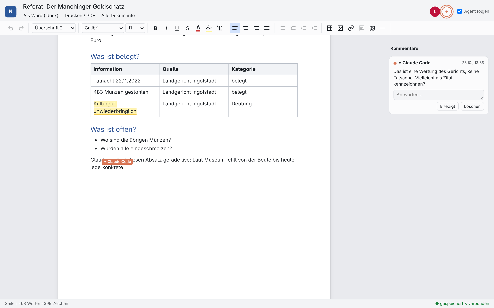
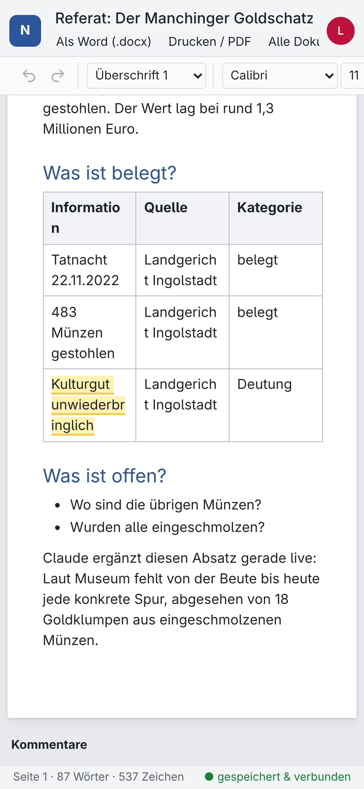

# Nexus Light

**Deutsch** · [English](#english)

> **Tipp:** Lass dir beim Einrichten von deinem KI-Assistenten helfen. Schick ChatGPT oder Claude den
> Link zu dieser Seite und schreib: *„Hilf mir, Nexus Light einzurichten. Die Anleitung für dich steht
> in AGENTS.md.“* Der Agent führt dich Schritt für Schritt durch.

**Live mit deinem KI-Agenten zusammenarbeiten.** Ein kleines Office und MCP-Server, den du selbst
betreibst, kostenlos, bei Cloudflare. Du schreibst im Browser, ChatGPT oder Claude schreiben live mit,
mit eigenem Cursor, Namen und Kommentaren.

- **Editor wie Word:** Formatvorlagen, Schriftarten, Farben, Listen, Tabellen, Links, Bilder, Kommentare, Drucken/PDF, Export als .docx
- **Gemeinsam in Echtzeit** für Menschen *und* KI-Agenten (Yjs); der Cursor des Agenten zeigt, wer gerade schreibt, und die Ansicht kann ihm folgen
- **MCP-Server mit OAuth:** als Connector in ChatGPT (auch im Gratis-Tarif) oder Claude hinzufügen
- **Teilen-Links** zum gemeinsamen Bearbeiten ohne Passwort
- **Als App installierbar** auf Handy, Tablet und PC
- Memory, Textdateien, Webseiten abrufen, **Backups** (.zip zum Herunterladen, optional jede Woche automatisch in die ByCS-Drive)
- Optional **ByCS** (BayernCloud Schule): Drive und Lernplattform für den Agenten
- Deine Daten liegen in **deinem eigenen** Cloudflare-Konto, standardmäßig in EU-Rechenzentren

<p align="center"> </p>

Du brauchst genau ein kostenloses Cloudflare-Konto. Keinen Server, keine Kreditkarte.

## Einrichten

### Weg 1: Deploy-Button

[](https://deploy.workers.cloudflare.com/?url=https://github.com/Das-L1/nexus-light)

Dafür brauchst du ein kostenloses Cloudflare- und ein kostenloses GitHub- (oder GitLab-) Konto.

1. **Git account:** Wähl dein **eigenes** GitHub-Konto. Steht dort eine Organisation, stell es im Auswahlfeld um.
2. **Project name:** frei wählbar. Hast du schon eine Nexus-Instanz, nimm einen **anderen Namen**, sonst wird sie überschrieben.
3. **OWNER_PASSWORD:** ein langes Passwort, das du dir merkst. Es schützt deine Dokumente, und du brauchst es beim Verbinden der KI.
4. **Deploy.** Der erste Build dauert 1 bis 3 Minuten.

### Weg 2: Kommandozeile

```sh
git clone https://github.com/Das-L1/nexus-light nexus-light && cd nexus-light
npm install
npx wrangler login
npx wrangler secret put OWNER_PASSWORD
npm run deploy
```

Dein Nexus läuft dann unter `https://nexus-light.<deine-subdomain>.workers.dev`.

### KI verbinden

**ChatGPT** (geht auch im Gratis-Tarif):

1. Öffne direkt das Formular: **<https://chatgpt.com/#settings/Connectors?create-connector=true>**
   (Nicht über „Plugins → + → Plugin erstellen“: Das öffnet den *Plugin Creator*, einen Chat, nicht das Formular.)
   Erscheint kein Formular, schalte zuerst den **Entwicklermodus** ein: Einstellungen → Plugins → *Entwicklermodus*. Das gilt pro ChatGPT-Konto; prüf unten links, mit welchem Konto du angemeldet bist.
2. **Name:** z. B. „Nexus Light“. **Verbindung:** Server-URL `https://<deine-instanz>.workers.dev/mcp`
3. **Authentifizierung:** OAuth. Bei „Erweiterte OAuth-Einstellungen“ nichts ändern (ChatGPT erkennt *Dynamische Client-Registrierung* selbst; der Hinweis „CIMD nicht verfügbar“ ist normal).
4. Haken bei „Ich verstehe …“, dann **Erstellen**.
5. Es öffnet sich die Nexus-Light-Seite: dein **OWNER_PASSWORD** eingeben und **Erlauben**.

**Claude:** Einstellungen → Connectors → *Eigenen Connector hinzufügen* → `https://<deine-instanz>.workers.dev/mcp`, dann wie oben anmelden.

Testen: Schreib der KI *„Ruf nexus_status auf“*. Sie sollte die Version und ihren Namen in Dokumenten nennen.

### Was der Agent kann

| Bereich | Werkzeuge |
|---|---|
| Dokumente | `doc_list`, `doc_create`, `doc_read`, `doc_write` (tippt live), `doc_replace_blocks`, `doc_replace_text`, `doc_delete_blocks`, `doc_point` (zeigt mit dem Cursor), `doc_link` (auch Teilen-Link), `doc_export` (Markdown oder .docx), `doc_rename`, `doc_remove` |
| Kommentare | `doc_comment`, `doc_comments`, `doc_comment_reply` (antworten, erledigen) |
| Sonstiges | `memory_save`/`_search`/`_delete`, `fs_list`/`_read`/`_write`/`_delete`, `web_fetch`, `util_time`, `nexus_status`, `backup_now`, `send_feedback` |
| ByCS (optional) | `bycs_drives`, `bycs_list`, `moodle_courses`, `moodle_deadlines`, `moodle_course_contents` |

Der Agent schreibt in Markdown: `#` Überschriften, `-`/`1.` Listen, `>` Zitate, `| Tabellen |`,
`**fett**`, `*kursiv*`, `<u>unterstrichen</u>`, `~~durchgestrichen~~`, `==markiert==`, `[Links](url)`, ``.

## Einstellungen

| Name | Art | Standard | Bedeutung |
|---|---|---|---|
| `OWNER_PASSWORD` | Secret | (Pflicht) | Anmeldung als Besitzer im Browser und beim Verbinden einer KI |
| `DATA_REGION` | Variable | `eu` | Speicherort der Daten. `""` = keine Einschränkung. Vor dem ersten Speichern festlegen: Bestehende Daten ziehen nicht um. |
| `PUBLIC_URL` | Variable | Adresse der Anfrage | Feste Adresse, falls du eine eigene Domain nutzt |
| `FEEDBACK_URL` | Variable | Empfänger des Entwicklers | Ziel des Werkzeugs `send_feedback`. `""` entfernt es. |
| `BYCS_USER`, `BYCS_PASS`, `BYCS_SCHOOL` | Secrets | nicht gesetzt | Nur für Technikleute: ByCS-Anmeldung als Secrets. Einfacher geht es auf der Einstellungsseite (siehe unten). |

### ByCS verbinden

In Nexus Light: Dokumentliste → **Einstellungen** → Schulnummer (steht in deiner Drive-Adresse, z. B. `0284.drive.bycs.de`), Benutzername und Passwort → **Verbinden und testen**. Die Anmeldung wird sofort geprüft; das Passwort wird verschlüsselt in deinem Cloudflare-Konto gespeichert (Schlüssel aus deinem Nexus-Passwort). Danach kann der Agent Drive und Lernplattform nutzen, und jeden Montag (03:00 UTC) landet ein Backup im Ordner `cowork Dateien backup`.

## Häufige Probleme

| Problem | Lösung |
|---|---|
| In ChatGPT gibt es kein Formular für eigene Server | Direktlink oben nutzen; sonst Entwicklermodus einschalten (pro Konto) |
| „Plugin erstellen“ öffnet einen Chat | Das ist der *Plugin Creator*, nicht das richtige Formular: Direktlink nutzen |
| Deploy: Fehler `10034` | Die E-Mail-Adresse bei Cloudflare ist noch nicht bestätigt |
| Deploy: GitHub zeigt nur Repos einer Organisation | Im Auswahlfeld dein eigenes Konto wählen |
| Deploy hat meine bestehende Instanz überschrieben | Beim Deploy immer einen neuen Projektnamen wählen |
| „Falsches Passwort“ beim Verbinden der KI | Gemeint ist das `OWNER_PASSWORD` *dieser* Instanz (beim Deploy gesetzt); ändern im Cloudflare-Dashboard unter Settings → Variables and Secrets |
| Die KI kennt neue Werkzeuge nicht | Nach einem Update das Plugin/den Connector in ChatGPT bzw. Claude einmal aktualisieren oder neu verbinden |
| Editor zeigt dauerhaft „verbinde …“ | WebSockets werden blockiert (Werbeblocker, Schul-WLAN): anderes Netz oder anderen Browser probieren |
| ByCS: „noch nicht verbunden“ | Dokumentliste → Einstellungen → ByCS verbinden |
| ByCS geht nach Passwortänderung nicht mehr | Die ByCS-Daten sind mit dem Nexus-Passwort verschlüsselt: in den Einstellungen neu verbinden |
| Neue Adresse lädt direkt nach dem ersten Deploy nicht | 1 bis 2 Minuten warten, eine neue `workers.dev`-Adresse braucht kurz im DNS |

## Warum es gratis und leicht bleibt

- Der Editor ist eine einzige statische Datei (ca. 125 KB komprimiert), die Cloudflare direkt ausliefert; der Worker startet dafür gar nicht.
- Layout, Formatierung, Verkleinern von Bildern und Cursor laufen im Browser. Der Worker prüft nur den Zugriff und reicht Daten weiter.
- Jedes Dokument ist ein Durable Object, das schläft, solange niemand tippt (WebSocket-Hibernation).
- .docx-Export und Backups entstehen in Durable Objects, nicht im Worker mit seinem 10-ms-Limit.
- Gemessen: Seitenaufruf ca. 2 ms CPU, MCP-Aufruf ca. 4 ms, jeder Tastendruck ca. 2 ms im Dokument.
- Im Browser (Galaxy Tab S8 Ultra, Chrome): 2–3 MB JavaScript-Speicher für ein Referat mit Tabelle und Kommentar; während der Agent live tippt, ca. 13 % eines Prozessorkerns.

## Backups

Für deine Daten bist du selbst verantwortlich. Lade in der Dokumentliste alles als .zip herunter
(*Backup aller Dokumente*) oder verbinde ByCS für eine automatische Kopie jede Woche. Ist dein
letztes Backup älter als 14 Tage, erinnert dich die KI daran.

## Feedback

Mit `send_feedback` kann der Agent dem Entwickler einen Fehler, Wunsch oder Lob schicken, aber nur,
nachdem er dir den genauen Text gezeigt hat und du zugestimmt hast. Mit `FEEDBACK_URL=""` ist die
Funktion ganz aus. Details unten unter Datenschutz.

## Datenschutz und Rechtliches

Keine Rechtsberatung. Ausführlich: [Rechtliche Hinweise](https://neuro-net.net/nexus-feedback/rechtliches) · [Impressum](https://neuro-net.net/nexus-feedback/impressum)

- **Du bist verantwortlich** (Art. 4 Nr. 7 DSGVO) für deine Instanz, auch für Daten von Personen, mit denen du Dokumente teilst.
- **Cloudflare ist dein Auftragsverarbeiter** (Art. 28 DSGVO). Der Auftragsverarbeitungsvertrag (Data Processing Addendum) ist Teil der Cloudflare-Bedingungen und gilt für dein Konto. Daten liegen standardmäßig in EU-Rechenzentren (`DATA_REGION="eu"`); Cloudflare ist ein US-Unternehmen, zertifiziert unter dem EU-US Data Privacy Framework. Gespeichertes ist verschlüsselt, Cloudflare kann als Betreiber aber technisch darauf zugreifen.
- **KI-Anbieter:** Liest oder schreibt ChatGPT, Claude oder ein anderer Assistent über MCP ein Dokument, gehen diese Inhalte an den Anbieter, unter dessen Bedingungen. Sag das den Personen, mit denen du teilst.
- **Teilen-Links** erlauben jedem, der sie hat, dieses eine Dokument zu lesen und zu bearbeiten. Namen im Dokument sind selbst gewählt und nicht geprüft. Es gibt nur technisch notwendige Cookies (Anmeldung, Zugriff per Teilen-Link; § 25 Abs. 2 TDDDG), kein Tracking. Lässt du andere deine Instanz nutzen, brauchst du einen eigenen Datenschutzhinweis.
- **Schule, Kinder und Jugendliche:** Bei Nutzern unter 16 können die Einwilligung der Eltern (Art. 8 DSGVO) und die Regeln von Schule oder Schulträger nötig sein. Nexus Light ist kein von einem Kultusministerium freigegebener Dienst.
- **ByCS** ist optional und meldet sich mit deinen eigenen Zugangsdaten an, die verschlüsselt in deinem Cloudflare-Konto liegen. Es gelten die ByCS-Bedingungen; Nexus Light ist kein offizieller ByCS-Dienst und steht in keiner Verbindung zum Freistaat Bayern. Die Anbindung kann aufhören zu funktionieren, wenn sich die ByCS-Anmeldung ändert (z. B. Zwei-Faktor).
- **Feedback** ist standardmäßig an, sendet aber nichts von selbst: Die KI muss dir den genauen Text zeigen, und du musst jeder Nachricht zustimmen. Gesendet werden nur dieser Text, eine Kategorie, die Version, der Name des Agenten und eine zufällige Installations-Kennung; nie Dokumente, Dateien, Zugangsdaten oder deine IP-Adresse. Gespeichert auf einem Server in der EU (Litauen), gelöscht nach 12 Monaten. [Datenschutzhinweis](https://neuro-net.net/nexus-feedback/datenschutz).
- **Keine Gewähr:** Nexus Light wird kostenlos und ohne Gewähr bereitgestellt. Die Haftung ist ausgeschlossen, soweit gesetzlich zulässig (nicht bei Vorsatz, grober Fahrlässigkeit oder Verletzung von Leben, Körper oder Gesundheit).

## Lizenz

MIT, siehe [LICENSE](LICENSE).

## Entwicklung

```sh
npm install
npm run build:client   # bündelt client/ nach public/editor.js
npm run deploy         # bauen + wrangler deploy
```

Unter Termux (Android) mit `npm install --os=linux --ignore-scripts` installieren und danach `./fix-termux.sh` ausführen: workerd und
esbuild haben keine Android-Version, und `wrangler dev` (lokale Laufzeit) geht dort nicht;
`wrangler deploy` schon.

Aufbau: `src/index.ts` (MCP-Werkzeuge, OAuth), `src/web.ts` (Seiten, Zugriff), `src/doc.ts`
(Dokument-Objekt), `src/store.ts` (gemeinsamer Speicher), `src/docx.ts` (Word-Export),
`src/bycs.ts` (ByCS), `client/` (Editor), `public/` (Editor-Bündel, App-Manifest, Icons).

---

<a id="english"></a>

# Nexus Light (English)

[Deutsch](#nexus-light) · **English**

> **Tip:** Let your AI assistant help you set it up. Send ChatGPT or Claude the link to this page and
> write: *"Help me set up Nexus Light. Your instructions are in AGENTS.md."* It will walk you through
> step by step.

**Live collaboration with your agent.** A small office and MCP server you host yourself, for free, on
Cloudflare. Write documents in the browser and watch ChatGPT or Claude edit them live, with their own
named cursor and comments.

- **Word-like editor:** styles, fonts, colors, lists, tables, links, images, comments, print/PDF, .docx export
- **Real-time co-editing** for people *and* AI agents (Yjs); the agent's cursor shows who is writing, and the view can follow it
- **MCP server with OAuth:** add it to ChatGPT (also on the free plan) or Claude as a connector
- **Share links** to co-edit without a password
- **Installable as an app** on phone, tablet and desktop
- Memory, text files, web fetch, **backups** (.zip download, optional weekly backup to the ByCS-Drive)
- Optional **ByCS** (BayernCloud Schule, the Bavarian school cloud): Drive and Lernplattform for the agent
- Data stays in **your own** Cloudflare account, in EU data centers by default

<p align="center"> </p>

You need exactly one free Cloudflare account. No server, no credit card.

## Setup

### Option 1: Deploy button

[](https://deploy.workers.cloudflare.com/?url=https://github.com/Das-L1/nexus-light)

Needs a free Cloudflare and a free GitHub (or GitLab) account.

1. **Git account:** pick your **own** GitHub account. If it shows an organization, switch it in the dropdown.
2. **Project name:** anything. If you already run a Nexus instance, use a **different name**, or it gets overwritten.
3. **OWNER_PASSWORD:** a long password you will remember. It protects your documents and you need it to connect your AI.
4. **Deploy.** The first build takes 1 to 3 minutes.

### Option 2: Command line

```sh
git clone https://github.com/Das-L1/nexus-light nexus-light && cd nexus-light
npm install
npx wrangler login
npx wrangler secret put OWNER_PASSWORD
npm run deploy
```

Your Nexus is now at `https://nexus-light.<your-subdomain>.workers.dev`.

### Connect your AI

**ChatGPT** (works on the free plan too):

1. Open the form directly: **<https://chatgpt.com/#settings/Connectors?create-connector=true>**
   (Not via "Plugins → + → Create plugin": that opens the *Plugin Creator*, a chat, not the form.)
   If no form appears, turn on **developer mode** first: Settings → Plugins → *Developer mode*. It is per ChatGPT account; check at the bottom left which account you are signed in with.
2. **Name:** e.g. "Nexus Light". **Connection:** server URL `https://<your-instance>.workers.dev/mcp`
3. **Authentication:** OAuth. Leave the advanced OAuth settings alone (ChatGPT detects *dynamic client registration*; "CIMD not available" is normal).
4. Tick "I understand …", then **Create**.
5. The Nexus Light page opens: enter your **OWNER_PASSWORD** and **allow** access.

**Claude:** Settings → Connectors → *Add custom connector* → `https://<your-instance>.workers.dev/mcp`, then sign in as above.

Test: ask the AI to *"call nexus_status"*. It should report the version and its name in documents.

### What the agent can do

| Area | Tools |
|---|---|
| Documents | `doc_list`, `doc_create`, `doc_read`, `doc_write` (types live), `doc_replace_blocks`, `doc_replace_text`, `doc_delete_blocks`, `doc_point` (points with its cursor), `doc_link` (incl. share link), `doc_export` (markdown or .docx), `doc_rename`, `doc_remove` |
| Comments | `doc_comment`, `doc_comments`, `doc_comment_reply` (reply, resolve) |
| Other | `memory_save`/`_search`/`_delete`, `fs_list`/`_read`/`_write`/`_delete`, `web_fetch`, `util_time`, `nexus_status`, `backup_now`, `send_feedback` |
| ByCS (optional) | `bycs_drives`, `bycs_list`, `moodle_courses`, `moodle_deadlines`, `moodle_course_contents` |

The agent writes markdown: `#` headings, `-`/`1.` lists, `>` quotes, `| tables |`, `**bold**`,
`*italic*`, `<u>underline</u>`, `~~strike~~`, `==highlight==`, `[links](url)`, ``.

## Configuration

| Name | Kind | Default | Meaning |
|---|---|---|---|
| `OWNER_PASSWORD` | secret | (required) | Owner sign-in in the browser and for connecting AI clients |
| `DATA_REGION` | var | `eu` | Where data is stored. `""` = no restriction. Decide before storing data: existing objects never move. |
| `PUBLIC_URL` | var | request origin | Canonical address, if you use your own domain |
| `FEEDBACK_URL` | var | developer's receiver | Where `send_feedback` posts. `""` removes the tool. |
| `BYCS_USER`, `BYCS_PASS`, `BYCS_SCHOOL` | secrets | unset | For technical users: ByCS login as secrets. The settings page (below) is easier. |

### Connect ByCS

In Nexus Light: document list → **Einstellungen** (settings) → school number (part of your Drive address, e.g. `0284.drive.bycs.de`), username and password → **Verbinden und testen**. The login is checked right away; the password is stored encrypted in your Cloudflare account (key derived from your Nexus password). Then the agent can use Drive and Lernplattform, and every Monday (03:00 UTC) a backup goes into the folder `cowork Dateien backup`.

## Common problems

| Problem | Fix |
|---|---|
| ChatGPT shows no form for custom servers | Use the direct link above; otherwise turn on developer mode (per account) |
| "Create plugin" opens a chat | That is the *Plugin Creator*, not the right form: use the direct link |
| Deploy error `10034` | Your Cloudflare email address is not confirmed yet |
| Deploy: GitHub only lists an organization's repos | Pick your own account in the dropdown |
| Deploy overwrote my existing instance | Always choose a new project name when deploying |
| "Falsches Passwort" when connecting the AI | It is the `OWNER_PASSWORD` of *this* instance (set during deploy); change it in the Cloudflare dashboard under Settings → Variables and Secrets |
| The AI doesn't know new tools | After an update, refresh or reconnect the plugin/connector once in ChatGPT or Claude |
| Editor stays on "verbinde …" | WebSockets are blocked (ad blocker, school Wi-Fi): try another network or browser |
| ByCS: "noch nicht verbunden" | Document list → Einstellungen → connect ByCS |
| ByCS stops working after a password change | The ByCS login is encrypted with the Nexus password: connect again in the settings |
| A new address does not load right after the first deploy | Wait 1 to 2 minutes; a new `workers.dev` address needs a moment in DNS |

## How it stays free and light

- The editor is one static file (~125 KB gzipped) served by Cloudflare's asset storage; the worker is not even started for it.
- Layout, formatting, image shrinking and cursors run in the browser. The worker only checks access and passes data on.
- Each document is a Durable Object that sleeps while nobody types (WebSocket hibernation).
- .docx export and backups are built inside Durable Objects, not in the 10 ms worker.
- Measured: page loads ~2 ms CPU, MCP calls ~4 ms, each keystroke ~2 ms in the document object.
- In the browser (Galaxy Tab S8 Ultra, Chrome): 2–3 MB of JavaScript memory for a short paper with a table and a comment; about 13 % of one CPU core while the agent types live.

## Backups

You are responsible for your own data. Download everything as .zip from the document list
(*Backup aller Dokumente*), or connect ByCS for an automatic weekly copy. The AI reminds you when your
last backup is older than 14 days.

## Feedback

With `send_feedback` the agent can send the developer a bug report, wish or praise, but only after
showing you the exact text and getting your OK. `FEEDBACK_URL=""` turns it off completely. Details
under privacy below.

## Privacy and legal notes

Not legal advice. Full text (German): [Rechtliche Hinweise](https://neuro-net.net/nexus-feedback/rechtliches) · [Imprint](https://neuro-net.net/nexus-feedback/impressum)

- **You are the controller** (GDPR Art. 4 No. 7) for your instance, including data of people you share documents with.
- **Cloudflare is your processor** (Art. 28 GDPR). Its Data Processing Addendum is part of Cloudflare's terms and applies to your account. Data is stored in EU data centers by default (`DATA_REGION="eu"`); Cloudflare is a US company certified under the EU-US Data Privacy Framework. Stored data is encrypted, but Cloudflare can technically access it as the operator.
- **AI providers:** when ChatGPT, Claude or another assistant reads or writes a document over MCP, that content goes to the provider under its terms. Tell people you share documents with.
- **Share links** let anyone holding them read and edit that one document. Names shown in documents are self-chosen and not verified. Only technically necessary cookies are used (sign-in, share access; § 25 (2) TDDDG); no tracking. If you let others use your instance, you need your own privacy notice.
- **Schools, children and teenagers:** for users under 16, parental consent (Art. 8 GDPR) and the rules of the school or school authority may apply. Nexus Light is not a service approved by a ministry of education.
- **ByCS** is optional and logs in with your own credentials, stored encrypted in your Cloudflare account. ByCS terms apply; Nexus Light is not an official ByCS service and not affiliated with the Free State of Bavaria. It can stop working if ByCS changes its login (e.g. two-factor authentication).
- **Feedback** is on by default but sends nothing on its own: the AI must show you the exact text and you must agree to each message. Sent are only that text, a category, the version, the agent's name and a random installation id; never documents, files, credentials or your IP address. Stored on a server in the EU (Lithuania) and deleted after 12 months. [Privacy notice](https://neuro-net.net/nexus-feedback/datenschutz).
- **No warranty:** Nexus Light is provided free of charge and as is. Liability is excluded as far as the law allows (not for intent, gross negligence or injury to life, body or health).

## License

MIT, see [LICENSE](LICENSE).

## Development

```sh
npm install
npm run build:client   # bundles client/ into public/editor.js
npm run deploy         # build + wrangler deploy
```

On Termux (Android), install with `npm install --os=linux --ignore-scripts`, then run `./fix-termux.sh`: workerd and esbuild ship no
Android builds, and `wrangler dev` (local runtime) does not work there; `wrangler deploy` does.

Layout: `src/index.ts` (MCP tools, OAuth), `src/web.ts` (pages, access), `src/doc.ts` (document
object), `src/store.ts` (shared store), `src/docx.ts` (Word export), `src/bycs.ts` (ByCS),
`client/` (editor), `public/` (editor bundle, app manifest, icons).
